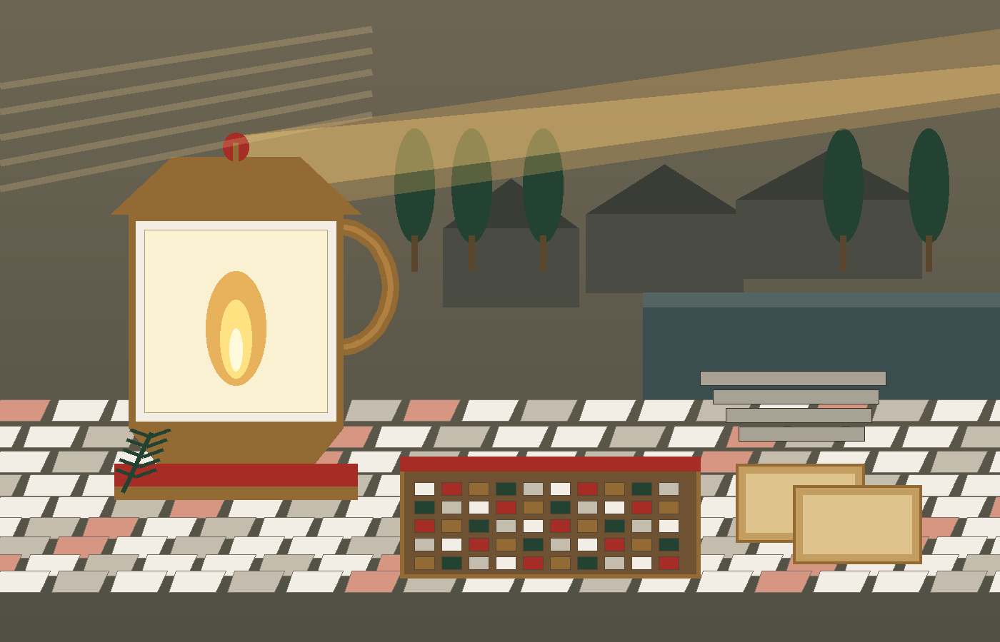
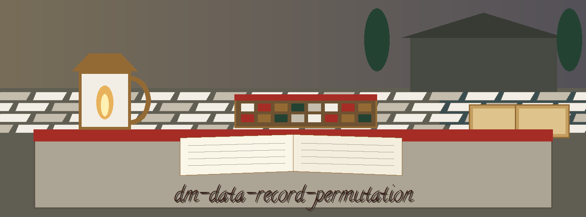

# dm-data-record-permutation

Chronicle entry, season of the first lamp lighting: the name above is set in Calligraffitti in roman red, and the Pharos lamp plate below stands as the header plate under the banner. Headings after this block stay typographic.

# dm-data-record-permutation
Randomly reorders the rows (records) in a data file. This disrupts the original order, which may unintentionally reveal information or patterns, particularly when combined with other masking techniques. - Focused on Tools designed to generate or mask sensitive data with realistic-looking but meaningless values

> Harbour log entry: a seed makes a shuffle repeat exactly.

> Harbour log entry: without a seed each run lands differently.

## Install
`git clone https://github.com/ShadowGuardAI/dm-data-record-permutation`

> Harbour log entry: the README clone line spells the organisation without its hyphen.

## Usage
`./dm-data-record-permutation [params]`

## Parameters
- `--file_type`: No description provided
- `--header`: Specify if the input file has a header row. If not specified, assume header exists.
- `--delimiter`: Delimiter for CSV files. Default is
- `--seed`: Seed for a reproducible shuffle. If not specified, each run shuffles from fresh system randomness and produces a different order.

Note on an absence: the delimiter sentence above stops at Default is, with no value printed in the source. No default is invented here.

## Shuffle and output path

By default each run is a fresh random shuffle, so the permutation is not fixed and cannot be inverted from the row count alone. Pass --seed with an integer to make a run reproducible: two runs with the same seed and the same input produce identical output.

The output file must not be the input file. If the resolved output path equals the resolved input path, the run refuses at exit 1 before any write, including when the same file is named through a ./ alias or a symlink.

> Harbour log entry: output that resolves to input refuses at exit 1 before any write.

## License
Copyright (c) ShadowGuardAI

## Rest at the harbour desk

The main button of this re-skin reads Shuffle the Rows. Its seed field label reads Shuffle Seed. Its guard heading reads Output Never Lands on Input. Its seed heading reads One Seed, One Order, Twice the Same. Buttons are small Pharos lamps in aged bronze over worn stone, roman red in their recesses, their rim a fine line of mosaic tesserae. Links are headed by a small tessellated floor square, bronze while idle, roman red while pointed at. Cards are log desks, marble white panels with bronze corners. It ends with the lamp burning low, the shuffled pages stacked square, and the log shut and handed on. What arrived in one order leaves in another.
